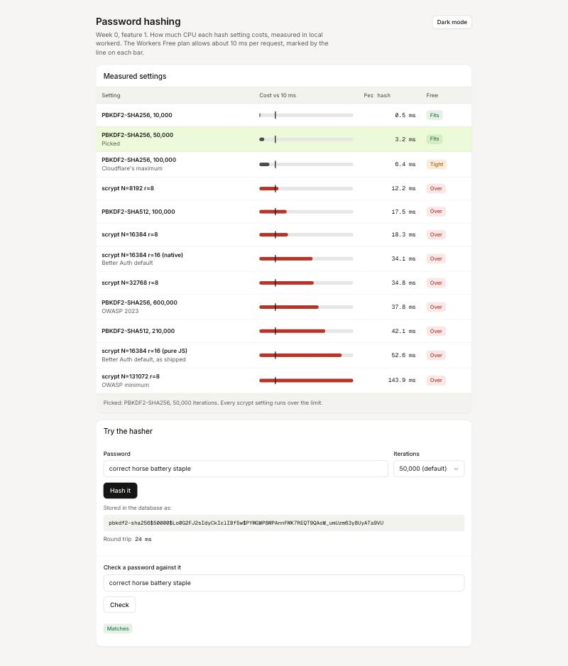

# Toolshed

**The free, open-source toolkit for launching a product: links, waitlist, forms, feedback, status page and analytics in one dashboard, deployed to your own Cloudflare account for $0–5 a month.**

> **Status: pre-alpha.** We are building the base platform (Week 0): sign-in, workspaces, roles, API keys, the module registry and the dashboard shell. Nothing here is deployable yet. Watch the repo, or read the [roadmap](#roadmap) to see what's coming.

Toolshed is a single Cloudflare Worker. One sign-in, one dashboard, many modules you switch on or off. It uses only Cloudflare: no Stripe, Twilio, Firebase, or OAuth apps to set up. You'll click **Deploy to Cloudflare** (or run `npm create toolshed@latest`) and get the whole thing in your own account.

## What's here today

| Part | Where | What it does |
|---|---|---|
| Password hasher | [`src/auth/hasher.ts`](src/auth/hasher.ts) | PBKDF2-SHA256 through Web Crypto, sized to fit the Workers Free plan's 10 ms CPU limit. Self-describing hashes, so the cost can be raised later |
| Hashing spike | [`spikes/hash/`](spikes/hash/) | The benchmark behind that choice: 12 scrypt and PBKDF2 settings, timed in Node and in workerd |
| Hasher demo | [`spikes/hash/demo/`](spikes/hash/demo/) | A local page that shows the measurements and lets you try the hasher |
| Design tokens | [`src/ui/toolshed.css`](src/ui/toolshed.css) | Colors, type and components for the dashboard, light and dark |
| Docs | [`docs/`](docs/) | [How passwords are stored](docs/passwords.md) |



## Quick start

You need Node.js 22 or newer.

```bash
git clone https://github.com/sairahul1526/toolshed.git
cd toolshed
npm ci
```

| Command | What it does |
|---|---|
| `npm test` | Runs the unit tests (Vitest) |
| `npm run typecheck` | Type-checks `src/` and `test/` |
| `npm run check` | Both of the above, the same as CI |
| `npm run demo:hash` | Starts the hasher demo at http://127.0.0.1:8798 |
| `npm run spike:hash:node` | Times every hash setting in Node |
| `npm run spike:hash:dev` | Starts the benchmark Worker in local workerd at http://127.0.0.1:8799, for `node spikes/hash/bench-workerd.mjs` |

Nothing here needs a Cloudflare account. Everything runs locally with `wrangler dev`.

## Project layout

```
src/            Product code (runs inside the Worker)
  auth/         Sign-in building blocks
  ui/           Design tokens and shared CSS
test/           Unit tests, one file per module in src/
spikes/         Throwaway experiments that answered a question. Kept for the numbers
docs/           Docs for people running Toolshed
```

## Roadmap

**Week 0, the base** (in progress): auth on Better Auth with passwords, email codes, passkeys and 2FA · workspaces, invites and roles · sessions and devices · owner admin · audit log · API keys and short-lived JWTs · email through Cloudflare Email Sending · rate limits · module registry · dashboard shell and themes · background jobs · deploy button · in-dashboard updates with rollback · onboarding · export everything · stable error codes.

**Then one module a week:** links, monitoring, forms, waitlist, feedback, analytics, images, email, then support tools (help center, help desk, live chat), developer tools (webhooks, feature flags, error tracking) and more.

## Why Cloudflare only

- **It's cheap.** Most installs fit the Workers Free plan. Heavy use costs about $5 a month on Workers Paid.
- **There's one install step.** You click the button and that's it: no keys to create at other services.
- **Your data stays yours.** It lives in D1, R2 and KV in your own account.

## Contributing

Issues and pull requests are welcome. Read [CONTRIBUTING.md](CONTRIBUTING.md) first. Please report security problems privately, as [SECURITY.md](SECURITY.md) explains.

## License

[MIT](LICENSE). "Toolshed" is a working name and may change before the first release.
